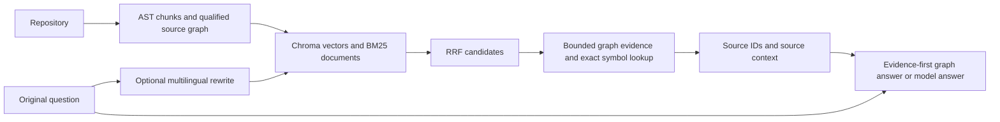

# Cross-Lingual Codebase GraphRAG

A local codebase assistant for finding and explaining source code from English, French, Chinese and mixed-language questions. The project is motivated by switching between Chinese, French and English while discussing the same code. It combines hybrid retrieval with Python source structure and returns inspectable source evidence.

This is an extended and substantially modified project based on [Repo-Sage](https://github.com/Ganesh-403/Repo-Sage), which supplied the original application architecture. This project adds multilingual query planning and evaluation, qualified Python source graphs, symbol grounding, structured evidence and evidence-first graph answers. See [licensing and provenance](docs/release_licensing.md) before redistribution.

## Features and architecture

- AST-aware Python chunking, plus other language chunkers; Chroma dense and BM25 lexical search combined with RRF.
- Optional EN/FR/ZH query rewriting, protected code identifiers and original-query fallback. Multilingual and experimental code-aware planning are disabled by default; see [configuration](backend/reposage/query/MULTILINGUAL_QUERY.md).
- Qualified source graph and exact symbol lookup, with bounded one-hop source evidence and file/line metadata. Existing indexes without a v2 sidecar retain legacy behavior; see [source graph setup](backend/reposage/query/SOURCE_GRAPH.md).
- Evidence-first answers for recognizable caller/callee questions with a qualified graph. Static references and unresolved calls are distinguished; a static edge does not prove runtime dispatch.
- Standard RAG, streaming responses and LangGraph Agent mode. Agent fallback may use RAG without executing tools; inspect execution metadata rather than assuming tool use. Evidence IDs such as `[S1]` map to source records; valid citation syntax does not establish factual support.



The stack uses FastAPI, Python, LangChain/LangGraph, NetworkX, Chroma, Ollama, React and Vite. The local model can omit citations, answer in the wrong language or make unsupported code claims. Evidence remains separately visible; review source before relying on an explanation.

## Evaluation

These are small automated, unreviewed engineering experiments, not independent human validation or general performance estimates. The frozen V1 set has 13 task records and 52 variants, using micrograd and a **synthetic fixture**, not two independent upstream repositories. Only 9 of 11 answerable tasks had all exact chunks indexed. The task-macro MRR@5 averages the four language variants within each eligible task. Translation used extra LLM calls.

| V1: 9 eligible tasks | Dense | BM25 | Raw RRF | Translation RRF |
|---|---:|---:|---:|---:|
| MRR@5 | 0.587 | 0.275 | 0.516 | 0.495 |

With identical raw RRF seeds, all-required-chunk context coverage was 0.694 with graph off, 0.806 with qualified graph, and 0.917 with exact grounding. Graph arms add context, so this is not equal-budget ranking improvement. A separate post-hoc cross-file supplement exposed a multi-symbol grounding regression; after the fallback fix qualified and grounded context both covered both targets in 4/4 variants, versus 1/4 graph off. Details: [V1 report](benchmarks/final_v1/REPORT.md) and [graph ablation](benchmarks/graph_ablation/README.md).

A separate [ItsDangerous supplement](benchmarks/itsdangerous_supplement/REPORT.md) uses seven source-derived tasks at a pinned Pallets revision; only three answerable tasks (12 variants) had all exact targets indexed. Dense / BM25 / raw RRF / translation RRF Hit@5 were 12/12, 0/12, 12/12 and 12/12; MRR@5 was 0.792, 0, 0.425 and 0.425. Caller complete-context coverage was 0/4 graph off and 4/4 graph on, at additional context cost. The cross-module case remained 0/4. Correlated variants and incomplete labels do not establish general improvement.

## Try it

With a micrograd index and v2 source graph available, example questions include:

- EN: `What does Value.backward call?`
- FR: `Qu'appelle Value.backward ?`
- ZH: `Value.backward 调用了哪些函数？`
- Mixed: `Who appelle Value.backward dans le graphe ?`
- Identifier-free: `Where does the code traverse the computation graph to propagate gradients?`

Exact symbol lookup is conservative. Identifier-free questions rely on retrieval and can miss the relevant symbol. Answer language is separate from finding evidence, and model responses are not guaranteed to follow it.

## Windows PowerShell setup

Prerequisites: Git, Python 3.11, Node.js compatible with the installed Vite version, and a running local Ollama service. Confirm `python --version` is 3.11 before creating the environment; on Windows, use the Python 3.11 executable explicitly if another version is first on PATH. A Python 3.13 fresh install here required Microsoft C++ build tools for `chroma-hnswlib`. From the project root:

```powershell
ollama pull qwen3:1.7b
ollama pull nomic-embed-text
cd backend
python --version  # must be Python 3.11
python -m venv .venv
.\.venv\Scripts\Activate.ps1
pip install -r requirements.txt
$env:OLLAMA_MODEL = 'qwen3:1.7b'
$env:OLLAMA_EMBED_MODEL = 'nomic-embed-text'
python main.py
```

In a second terminal:

```powershell
cd frontend
npm install
npm run dev
```

Open `http://localhost:5173` and index a repository via the UI; the API is at `http://localhost:8000/docs`. Indexing an existing repository name replaces that index, so use a new name or an isolated data directory. The API also supports remote GitHub URLs. For existing indexes, configure a compatible v2 sidecar using the source-graph instructions above. To enable multilingual rewriting for the backend process, set `$env:ENABLE_MULTILINGUAL_QUERY_PLANNING='true'` before starting it; set it to `false` or remove the variable to disable. See `.env.example` for other options; this setup does not require editing an existing `.env`.

For Docker Compose, provide a separate `.env` with `OLLAMA_BASE_URL=http://host.docker.internal:11434` and `CHROMA_PERSIST_DIR=/app/chroma_db`, configure Ollama to accept the container connection, then run `docker compose up -d --build`. The frontend uses port 5173 and API uses 8001. Review network exposure before binding Ollama externally.

Checks from the project root:

```powershell
backend/.venv/Scripts/python.exe -m pytest backend/tests -q
backend/.venv/Scripts/python.exe -m pip check
cd frontend
npm run test
npm run lint
npm run build
```

## Limitations and next work

Python static analysis cannot fully resolve dynamic dispatch, inheritance or all imports. Short functions may not have exact indexed chunks, and graph sidecars must match the indexed revision. The local model's general explanations need source review; deterministic graph responses cover only narrow caller/callee cases. Priorities are better handling of missing exact chunks and conservative cross-module resolution, plus broader source-checked evaluation across real repositories.

## Attribution and licensing

The root [MIT license](LICENSE) covers RosieMeng's original contributions as described in [ATTRIBUTION.md](ATTRIBUTION.md). The upstream Repo-Sage README explicitly states MIT, but its linked license file and original copyright notice were absent from the inspected tree. See the [licensing notes](docs/release_licensing.md) for the scope and remaining uncertainty. ItsDangerous is a separate BSD-3-Clause evaluation repository and is not bundled wholesale.

The [third-party audit](docs/third_party_audit.md) describes inherited assets and dependency license gaps. Selected frontend runtime notices are included in [THIRD_PARTY_NOTICES.txt](frontend/public/THIRD_PARTY_NOTICES.txt). Review the full dependency notices for the specific distribution being shipped.
